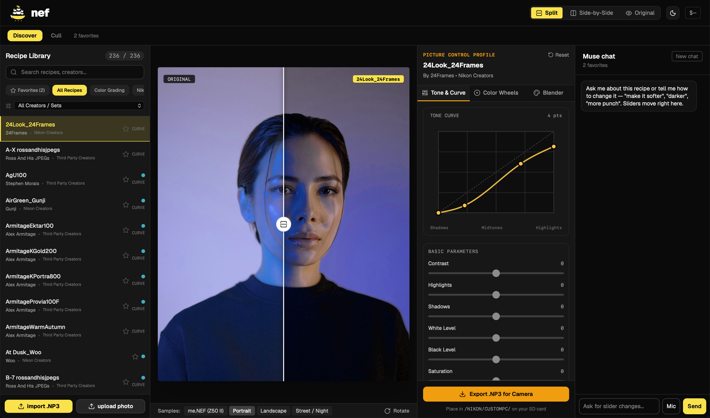
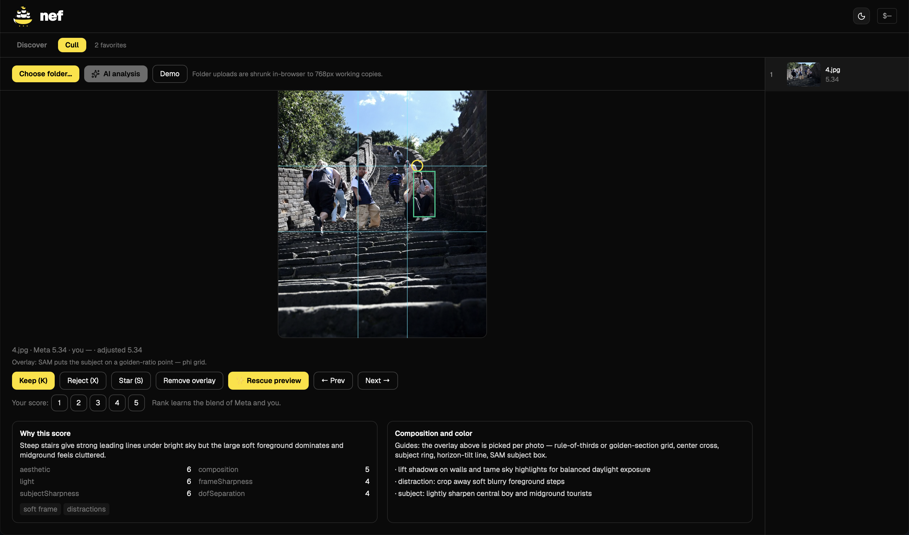

# nef — Meta Hackathon

An AI-assisted culling and recipe studio for Nikon photographers. Import a folder of
photos, get Meta-ranked review with plain-language reasons, talk to your pictures to
regrade them, and discover flexible Picture Control recipes in the browser — then
take the look back to your camera as a real `.NP3` file.



*Discover: browse 236 recipes, watch the transform live, and tell the chat what to change.*



*Cull: folder import, Meta scoring, per-photo guides, and one-click rescue previews.*

## The 60-second demo

1. **Discover** — pick a recipe, watch a portrait transform in the browser. Drag the
   before/after slider.
2. **Chat** — type *"make it softer"* or *"reduce the intensity of the colors"* and
   watch the sliders move themselves. Press **Mic** and just say it.
3. **Favorites** — star recipes you love, then ask *"what is similar about my fav
   recipes?"* The assistant reads your taste back to you (it will call out an
   all-black-and-white set) and blends a new filter from your picks. Export it as
   `.NP3` straight to your SD card path.
4. **Cull** — choose a folder of photos, press **✨ AI analysis**. Every photo is
   scored by Muse Spark, segmented by SAM 3.1, and ranked with composition
   overlays, score breakdowns, and rescue previews that erase background tourists
   via Muse Image.
5. **Cost** — every Meta call is tracked live. The `$` button in the header shows
   cumulative spend; the spend page breaks it down by model.

Built end to end with Muse Spark — the chat, the taste blending, even this
README's demo script came out of the same loop.

## Features

| Area | What it does |
| --- | --- |
| Discover | 236-recipe library with search, category/creator filters, and a Favorites-only view. Live WebGL preview: tone curve, blender, wheels, split/toggle compare, rotate, sample photos or your own upload. |
| Chat + MCP tools | Muse Spark interprets vague asks (*"moodier"*, *"dreamier"*) into validated slider patches against your live settings. Text and voice input; never volunteers summaries you didn't ask for. |
| Favorites → taste | Star recipes anywhere — they persist across restarts. Ask what they share and get a real answer, plus a Taste Blend filter from your averaged values. |
| `.NP3` round-trip | Import any `.NP3` (drop it on the preview) and export the current settings back out for `NIKON/CUSTOMPC` on your SD card. |
| Cull review | Folder upload (shrunk in-browser to 768px working copies), deferred AI analysis on your tap, one-by-one review with Keep/Reject/Star, your 1–5 score blended with Meta's, keyboard shortcuts, undo-safe picks. |
| Composition overlays | Guide picked per photo from SAM's own output: rule-of-thirds grid, phi grid, center cross, subject ring, horizon-tilt line, distraction boxes. Toggleable per photo. |
| Rescue previews | Muse Image cleanup for flagged frames — removes background distractions, keeps subject and light. |
| Cost tracking | Every live call (Spark, SAM, voice, image) is counted and priced with placeholder rates in `/cost`, persisted across restarts in `nef/data/cost.json`. `$` button in the header; JSON at `/api/cost`. |

## Getting started

Prerequisites: **Node 20+**, **ffmpeg** (voice transcription and preview prep), and a
Meta API key.

```bash
# 1. API key (never committed — nef/.env is git-ignored)
echo 'MODEL_API_KEY=your-key-here' > nef/.env

# 2. Start the API (port 4173, LIVE when the key is set, mocks otherwise)
npm start --prefix nef

# 3. Start the web app (port 5173) — new terminal
cd web && npm install && npm run dev -- --host 127.0.0.1 --port 5173

# 4. Open http://127.0.0.1:5173 in your browser
```

No key? Everything still runs — the server falls back to deterministic mocks and
says so on the health endpoint.

## Configuration

| Variable | Where | Default | What |
| --- | --- | --- | --- |
| `MODEL_API_KEY` | `nef/.env` | — | Turns on LIVE Meta calls. Absent = mock mode. |
| `CULL_MOCK` | env | — | Set `1` to force mocks even with a key. |
| `PORT` | env | `4173` | API port. |
| `COST_SPARK_CALL` | env | `0.02` | Placeholder $/call for `muse-spark-1.3`. |
| `COST_SAM_CALL` | env | `0.01` | Placeholder $/call for `sam-3.1`. |
| `COST_VOICE_CALL` | env | `0.005` | Placeholder $/call for voice transcribe. |
| `COST_IMAGE_CALL` | env | `0.02` | Placeholder $/call for `muse-image-1.0`. |

Costs are estimates until real price-book values are set — that's stated on the
spend page itself.

## API cheat sheet

Base `http://127.0.0.1:4173`. Full contract: [nef/docs/specs](nef/docs/specs).

| Endpoint | What |
| --- | --- |
| `GET /api/health` | Live vs mock, key present, model IDs. |
| `GET /cost` · `GET /api/cost[?sessionId=]` | Spend page · JSON totals. |
| `POST /api/chat` | Chat with tool-call patches (`{messages, context, settings, tools?}`). |
| `POST /api/voice/audio` | Raw audio → transcript + parsed command. |
| `POST /api/upload-begin` → `/api/upload` → `/api/upload-finish` | Browser upload flow (pass `defer:true` to skip auto-analysis). |
| `POST /api/analyze` | Score a stored session on demand. |
| `POST /api/decision` | Keep/reject/star/note; returns frame + live-distilled taste + counts. |
| `POST /api/image/rescue` | Muse Image cleanup for a flagged frame. |
| `GET /preview/:sid/:file` · `GET /rescue/:sid/:file` | Preview and cleanup files. |

## Project layout

```
web/                    # React + Vite app (Discover, Cull, chat, cost button)
  src/lib/              # colorEngine + WebGL preview, MCP tools, taste math
  docs/screenshots/     # the screenshots above
nef/                     # Node API: sessions, picks, Meta adapters, cost ledger
  src/meta/             # models.mjs (all model IDs), real + mock adapters
  server/               # index.mjs routes, picks, NEF preview extraction
  tests/app.test.mjs    # node:test suite (run: npm test --prefix nef)
api/taste.py            # Python mirror of the taste-averaging helper
web/scripts/            # recipe build + NX Studio ground-truth verification
```

## Honest limitations (judge notes)

- The preview is a custom approximation of Nikon's pipeline, fitted against NX
  Studio ground truth — close, not pixel-perfect. True Nikon rendering happens
  in-camera from the exported `.NP3`.
- Clarity and sharpening are stored in `.NP3` and round-trip correctly, but the
  WebGL preview does not apply them yet. The chat says so when relevant.
- Uploaded cull photos are 768px working copies (fast uploads, tiny API bills);
  server-path imports keep full resolution. Picks move whichever copy was imported.
- Image rescue, voice, and taste distillation need the API key; everything else
  degrades to mocks by design.
